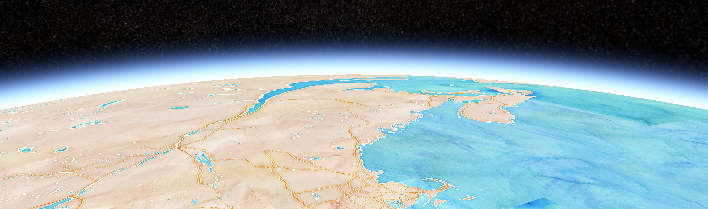

# Welcome to PhantaSpace

## What's PhantaSpace?

PhantaSpace is something new. It's very hard to categorize it. You can say it's an earth-scale NFT gallery, 3D NFT marketplace, a marketplace with the world as your storefront, Roblox for the real-world, pokemon go for NFTs, the skyline of ghost in the shell, or an app store for AR contents.
for NFT collectors and artists that want to promote and sell their NFTs in an immersive mixed reality (MR) experience, we are a metaverse that provides MR tech stacks and a check-in-to-earn mechanism to attract users.

Right now, PhantaSpace is an earth-scale NFT gallery. NFT artist or collectors can place their artworks in our earth-scale metaverse 1:1 to the 3D world map. The fun part is that users will see those arts in the real world with AR devices including a mobile AR app or AR glasses in the future. In order to make it decentralized, we created space NFT where users can own the space in our metaverse. Our unique 3D geocode system enables the user to split the space into any scale for flexible ownership. Our first-of-the-kind on-chain auction smart contract enables flexible pricing for the space NFT minting. In order to bootstrap the community, we created a check-in-to-earn mechanism with our Phanton utility token. Space owners and NFT promotors can attract viewers by staking Phanton and rewarding visitors. NFT promotors can stake Phanton to hold a space for NFT gallery. Soon we will let users buy NFTs directly on PhantaSpace. Space owners can collect rent from stacked Phanton on the NFT in their space. Real-world retailers can attract visitors by stacking Phanton or profit from their traffic by owning the space.

Next up, we will turn the real world into games. You can pick up an NFT on your way traveling around the world, earn Phanton, and meet up with friends with the same NFT group. People online and in the real world can coexist in a location in mixed reality. How fun is that!

Eventually, PhantaSpace will be a multiverse, an app store for AR contents, and a fantasy of infinity metaverse.
