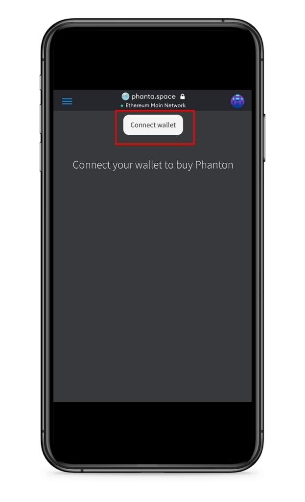
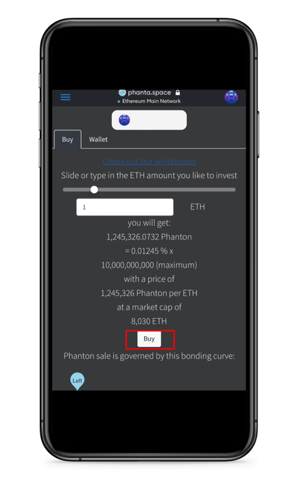

# 🚀 Phanton

### Origin

PhantaSpace utility token is named "Phanton" which is derived from the light particle, photon. The basic unit of Phanton is "eV". 1 Phanton = $$10^9$$ eV = 1 GeV.

### Supply

The maximum supply of Phanton is $$10^{10}$$ GeV. The total supply of Phanton will change over time to approach the maximum supply.

## Utility

### Check-in-to-earn

One of the utilities of Phanton is to be used as a currency in the check-in-to-earn mechanism. For example, if the owner of the space wants to attract users to visit the space, he/she can use Phanton to reward the visitor. NFTs will have more exposure in the space with the increase of visitors. The more exposure, the more value NFTs will have. Another example is if the owner of a real-world space, like a restaurant/shopping mall/theme park, wants to attract users to visit the space, he/she can use Phanton to reward the visitors/shoppers.

Online check-in-to-earn will take place in our [Jump In](https://phanta.space/#/jumpin) section. Stay tuned…

### NFT ranking

Another utility of Phanton is to be used as a measure of the importance of the NFT. For example, if an important space attracts a lot of NFTs, the owner of the NFT can deposit Phanton to their NFTs. The more Phanton the owner deposit, the more important the NFT. When two NFT collide, the one with more Phanton will be shown in the space. On the other hand, the owner of the space can manage the NFTs in their space with the measure of Phanton. The space owner can set a minimum Phanton requirement to display the NFTs. The space owner can also charge a recurrent fee based on the Phanton deposit. This way, the contents in PhantaSpace can be curated by the space owners in a decentralized way. The space owner can use the earned Phanton to attract users by the check-in-to-earn mechanism. This way, the space will benefit NFT owners to have more exposure to their NFTs. Reciprocally, the space owner attracts more high-value NFTs and collects more fees, and the NFT owners gain more exposure to their NFTs by depositing more Phanton. The check-in-to-earn and NFT ranking activity will eventually accumulate Phanton in the space and NFT. Since the maximum supply of Phanton is fixed, the result is deflation in the long run.

### Buy Phanton

