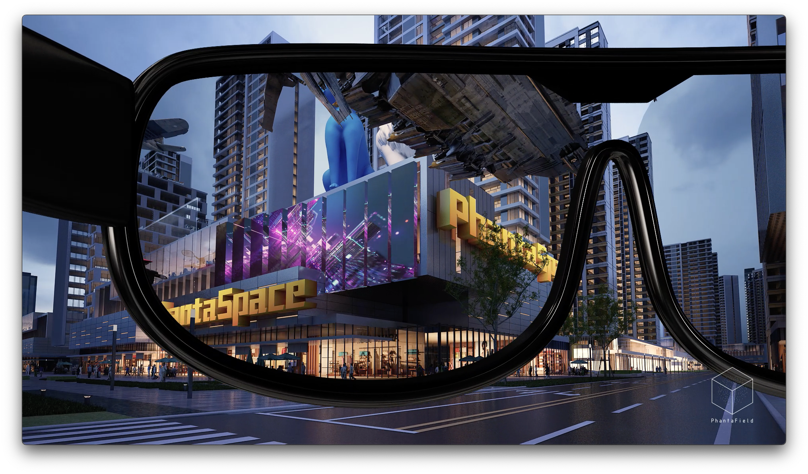

# 👓 Mixed Reality

## Grand vision

The PhantaSpace is an open metaverse built on top of a 3D earth map. This enables the creation of a virtual world that is in parallel with the real world before the dawn of mixed reality. All the NFTs and virtual contents placed in PhantaSpace will be visible to all the users in the real world. At first, it's just a website, then it will be an augmented reality (AR) mobile app, and finally, it will be a fundamental digital layer built into the augmented reality glasses operating system.

## PhantaField AR glasses

In parallel with PhantaSpace, our team is working on the PhantaField AR glasses. We are building integrated circuits on glasses lenses to make Ironman-style AR glasses with 100-degree field of view and retina resolution. All the current solutions for AR glasses are like the circuit board in the age of discrete circuit components. Images from microdisplay are projected into human eyes with the diffraction of partial reflection by several discrete components. It's very hard to have a high level of integration and bad performance renders it useless. All of the industry experts think that the technology is not there, and AR glasses will have mass adoption 10 years later. Our approach is using the latest semiconductor breakthrough (2D semiconductor) to directly integrate microLED, integrated circuits, and micro-optics into a transparent lens. Using microLED, we could make it retina resolution, using integrated micro-optics and our patented orthogonal light field optical system, we could create more than a 100-degree field of view with super high efficiency. All this is possible due to our proprietary 2D semiconductors technology that allows us to create 3D integration of high-performance integrated circuits with a transparent form. A lightweight AR glasses with such performance can replace every display in the world, smartphones, laptops, PC, television, and even movie theaters. The world will be your display.
